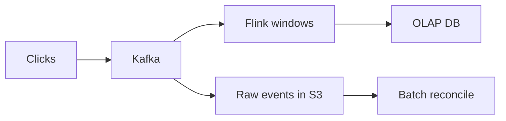

# 56. Design an ad click aggregation system.

> Part B: Classic System Designs

**Answer:** Click events -> Kafka -> stream processor (Flink) with tumbling windows aggregates per ad/minute, dedup by click id, late data via watermarks; store aggregates in OLAP DB (Druid/ClickHouse) and raw events in object storage; reconcile with batch (lambda/kappa).

---
[⬆ Back to index](../../README.md#-question-index)
