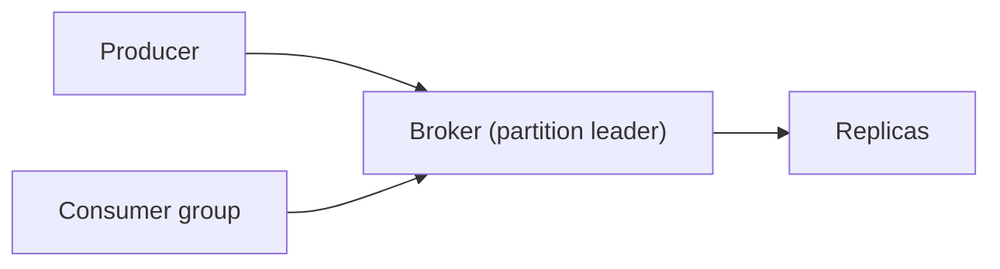

# 57. Design a distributed message queue.

> Part B: Classic System Designs

**Answer:** Topics split into partitions, each an append-only log replicated (leader + ISR); producers pick partition by key; consumer groups track offsets; segment files, page cache, zero-copy; controller via ZooKeeper/Raft; retention and compaction.

---
[⬆ Back to index](../../README.md#-question-index)
