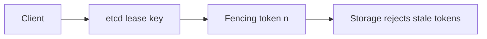

# 59. Design a distributed lock service.

> Part B: Classic System Designs

**Answer:** Use Redis SET NX PX with unique token + Lua release, or better ZooKeeper/etcd ephemeral nodes with leases. Add fencing tokens (monotonic) so stale holders cannot write. Beware clock drift, GC pauses, and prefer idempotency over locks where possible.

---
[⬆ Back to index](../../README.md#-question-index)
