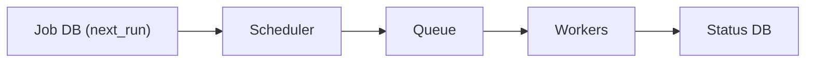

# 60. Design a distributed job scheduler.

> Part B: Classic System Designs

**Answer:** Store jobs (cron, one-off) in DB with next_run time; scheduler nodes (leader-elected or partitioned) poll and enqueue due jobs to a queue; workers execute with leases/heartbeats; retries, priorities, idempotency, dedup to avoid double execution, DAG dependencies (Airflow).

---
[⬆ Back to index](../../README.md#-question-index)
