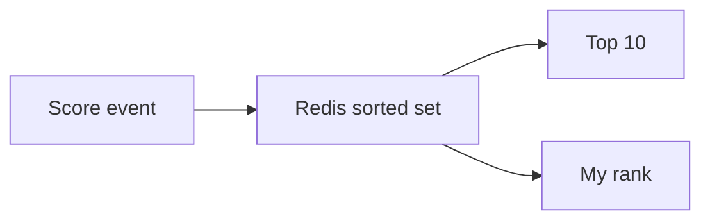

# 61. Design a leaderboard.

> Part B: Classic System Designs

**Answer:** Redis sorted sets (ZADD, ZREVRANGE, ZRANK) give O(log N) updates and top-K; shard by score range or user for huge scale; persist to DB; periodic snapshots for daily/weekly boards; approximate rank for large N.

---
[⬆ Back to index](../../README.md#-question-index)
