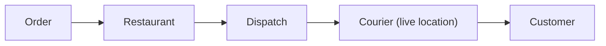

# 63. Design a food delivery system (DoorDash/Swiggy).

> Part B: Classic System Designs

**Answer:** Services: restaurants/menu, search, order, dispatch, tracking, payments, ETA. Dispatch matches courier by proximity and batching; order state machine with events; live location via streaming; ETA models.

---
[⬆ Back to index](../../README.md#-question-index)
