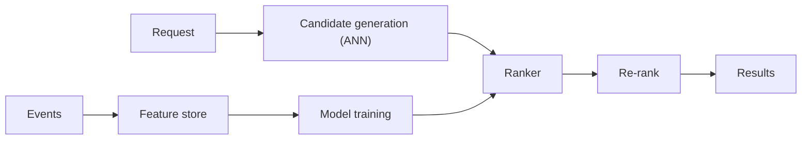

# 64. Design a recommendation system.

> Part B: Classic System Designs

**Answer:** Two stages: candidate generation (collaborative filtering, embeddings + ANN search) then ranking (ML model with features from a feature store), then re-ranking (diversity, business rules). Offline training pipeline + online serving, A/B testing, feedback loop.

---
[⬆ Back to index](../../README.md#-question-index)
