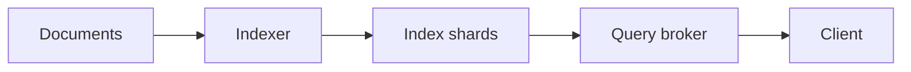

# 65. Design a search engine (Google/Elasticsearch).

> Part B: Classic System Designs

**Answer:** Crawl -> parse -> build inverted index (term -> postings) sharded by document; query: tokenize, fetch postings across shards, rank (BM25/PageRank/ML), merge results; caching, spell correction, index refresh via segments.

---
[⬆ Back to index](../../README.md#-question-index)
