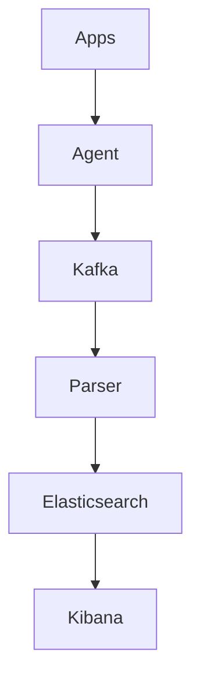

# 66. Design log aggregation (ELK/Splunk).

> Part B: Classic System Designs

**Answer:** Agents (Filebeat/Fluentd) ship logs -> Kafka buffer -> parser/enricher -> index (Elasticsearch) hot/warm/cold tiers + raw archive in object storage; retention, sampling, PII scrubbing, dashboards and alerts.

---
[⬆ Back to index](../../README.md#-question-index)
