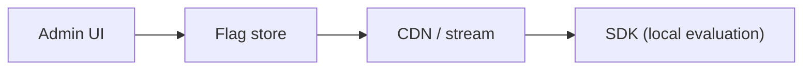

# 68. Design a feature flag service.

> Part B: Classic System Designs

**Answer:** Flag configs in DB/control plane, pushed to SDKs via streaming/polling and cached locally so evaluation is local and fast; targeting rules (percentage, segment, hash of user id); audit log, kill switches, fail-safe defaults.

---
[⬆ Back to index](../../README.md#-question-index)
