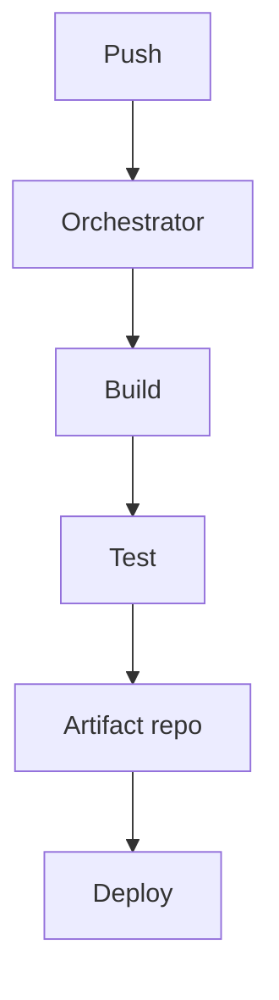

# 69. Design a CI/CD system.

> Part B: Classic System Designs

**Answer:** Webhook triggers pipeline; orchestrator schedules stages (build, test, scan, deploy) as DAG on elastic worker pool (containers); artifact registry, caching, secrets, parallel tests; deploy via canary/blue-green with auto rollback.

---
[⬆ Back to index](../../README.md#-question-index)
