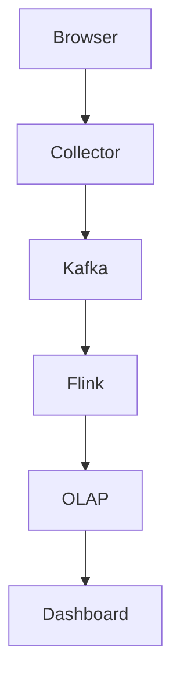

# 70. Design a web analytics system (Google Analytics).

> Part B: Classic System Designs

**Answer:** JS tracker -> collector endpoint -> Kafka -> stream processing (sessionization, dedup, bot filter) -> OLAP store for dashboards; raw data lake for batch; sampling/pre-aggregation to control cost.

---
[⬆ Back to index](../../README.md#-question-index)
