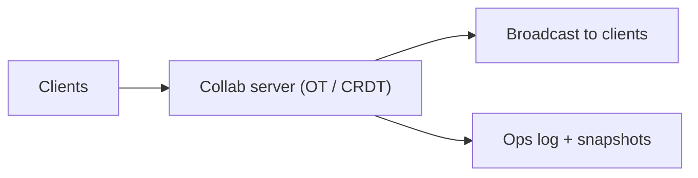

# 71. Design Google Docs (real-time collaborative editing).

> Part B: Classic System Designs

**Answer:** Concurrent edits merged by Operational Transformation (central server transforms ops) or CRDTs (commutative, peer-friendly). WebSocket per doc session, ops log + periodic snapshots, cursor presence, offline sync, version history.

---
[⬆ Back to index](../../README.md#-question-index)
