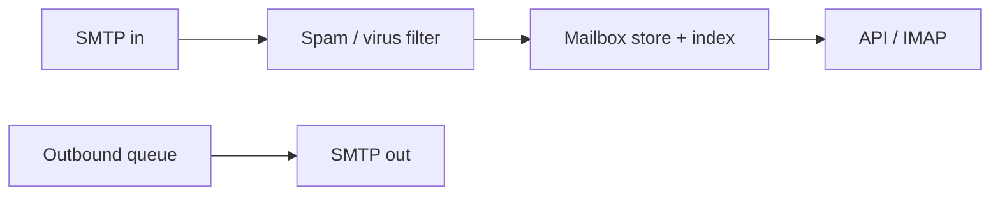

# 72. Design an email service (Gmail).

> Part B: Classic System Designs

**Answer:** SMTP ingest -> spam/virus filter -> mailbox store (per-user partition, wide-column) + search index; IMAP/web API for reads; attachments in object store; queues for outbound with retries; SPF/DKIM/DMARC.

---
[⬆ Back to index](../../README.md#-question-index)
