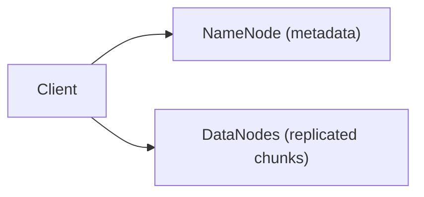

# 74. Design a distributed file system (GFS/HDFS).

> Part B: Classic System Designs

**Answer:** Master/NameNode stores namespace and chunk locations; files split into large chunks (64-128MB) replicated 3x across racks; clients read/write directly to chunkservers; heartbeats, re-replication, write pipeline.

---
[⬆ Back to index](../../README.md#-question-index)
