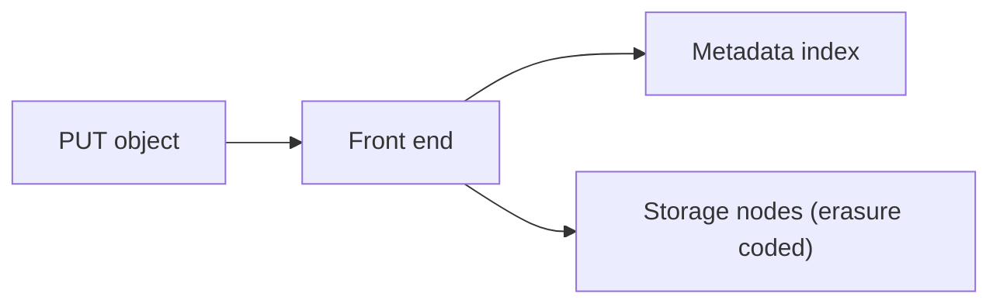

# 75. Design S3 (object store).

> Part B: Classic System Designs

**Answer:** Flat key space with metadata index (partitioned) separate from data layer; objects stored with replication or erasure coding across AZs; multipart upload, versioning, lifecycle policies, strong read-after-write consistency, checksums and scrubbing for durability (11 nines).

---
[⬆ Back to index](../../README.md#-question-index)
