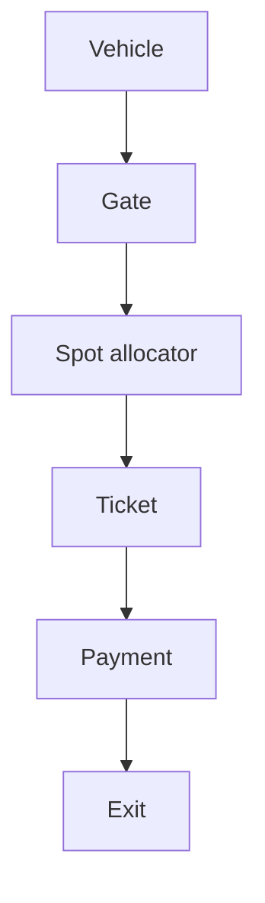

# 76. Design a parking lot / elevator system (low-level design).

> Part B: Classic System Designs

**Answer:** Identify entities (Lot, Level, Spot, Ticket, Vehicle, Payment), use enums and state machines, strategy pattern for pricing/spot allocation, thread-safe allocation, then extend to distributed (sharded by lot, DB constraints).

---
[⬆ Back to index](../../README.md#-question-index)
