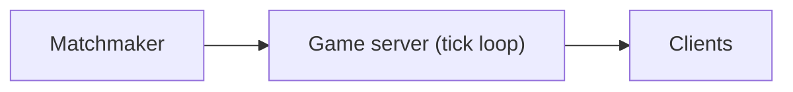

# 77. Design a multiplayer game backend.

> Part B: Classic System Designs

**Answer:** Authoritative game servers with tick loops (20-60Hz), UDP/WebSocket, client prediction + reconciliation, matchmaking service (skill/latency), regional shards, session state in memory with snapshots, anti-cheat.

---
[⬆ Back to index](../../README.md#-question-index)
