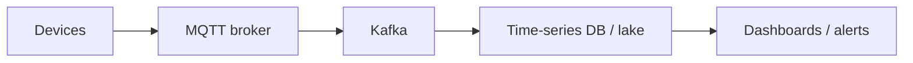

# 78. Design an IoT telemetry platform.

> Part B: Classic System Designs

**Answer:** Devices publish via MQTT to brokers -> Kafka -> stream processing -> time-series DB + cold storage; device registry/shadow, OTA updates, auth via certificates, edge aggregation for intermittent connectivity.

---
[⬆ Back to index](../../README.md#-question-index)
