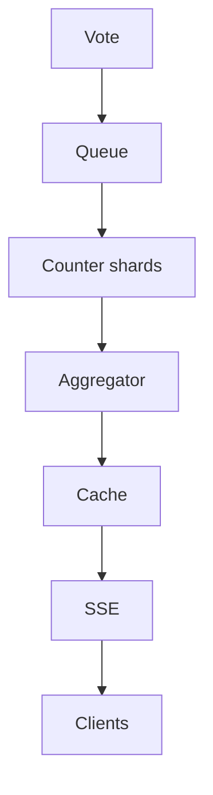

# 80. Design an online voting / polling system with real-time results.

> Part B: Classic System Designs

**Answer:** Writes via queue to prevent overload, dedup per user with unique constraint, sharded counters aggregated periodically, results broadcast via SSE/WebSocket from cache; integrity via auditing and idempotency.

---

---
[⬆ Back to index](../../README.md#-question-index)
