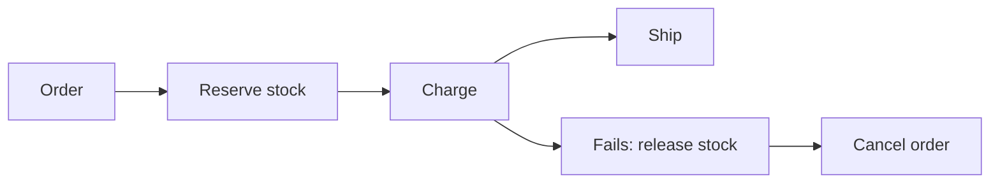

# 81. What is the Saga pattern?

> Part C: Advanced Patterns and Reliability

**Answer:** Long-running distributed transaction as a sequence of local transactions, each with a compensating action. Orchestration (central coordinator) vs choreography (events). Gives eventual consistency without 2PC locks.

---
[⬆ Back to index](../../README.md#-question-index)
