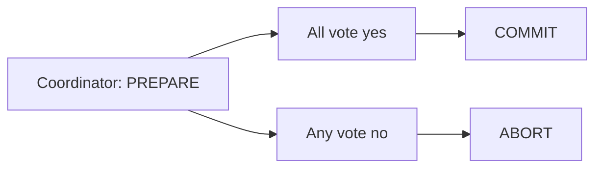

# 82. Two-phase commit (2PC) vs 3PC vs Saga?

> Part C: Advanced Patterns and Reliability

**Answer:** 2PC: coordinator asks prepare, then commit; atomic but blocking if the coordinator fails and slow. 3PC reduces blocking but is rarely used. Saga trades atomicity for availability. Use 2PC inside tightly-coupled DBs, Saga across services.

---
[⬆ Back to index](../../README.md#-question-index)
