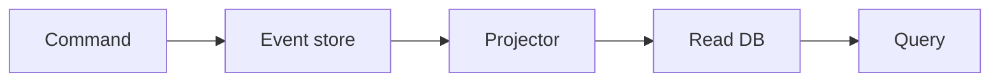

# 83. CQRS and Event Sourcing?

> Part C: Advanced Patterns and Reliability

**Answer:** CQRS separates write model from optimized read models. Event sourcing stores every state change as an immutable event; state = replay; supports audit and time travel; requires snapshots and event versioning. Projections update read stores asynchronously.

---
[⬆ Back to index](../../README.md#-question-index)
