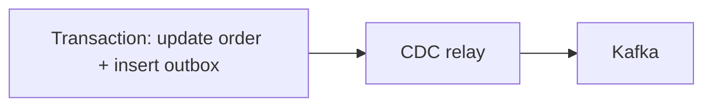

# 84. Transactional Outbox pattern?

> Part C: Advanced Patterns and Reliability

**Answer:** Write business data and an outbox event row in the same DB transaction; a relay (poller or CDC like Debezium) publishes to the broker. Guarantees no lost or phantom events; consumers must be idempotent.

---
[⬆ Back to index](../../README.md#-question-index)
