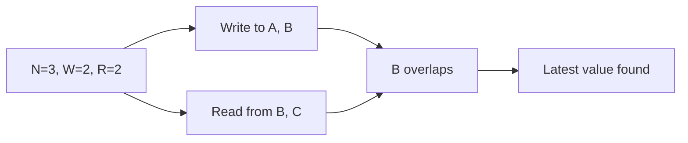

# 87. Quorum reads/writes?

> Part C: Advanced Patterns and Reliability

**Answer:** With N replicas, write to W and read from R; R+W>N guarantees overlap with the latest write. Tune: W=N (fast reads), R=1; or majority for balance. Sloppy quorums + hinted handoff boost availability.

---
[⬆ Back to index](../../README.md#-question-index)
