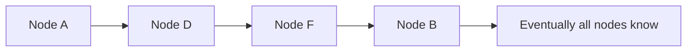

# 88. Gossip protocol and failure detection?

> Part C: Advanced Patterns and Reliability

**Answer:** Nodes periodically exchange state with random peers; information spreads in O(log N) rounds; scalable membership and failure detection (heartbeat counters, phi-accrual) without a central coordinator (Cassandra, Consul).

---
[⬆ Back to index](../../README.md#-question-index)
