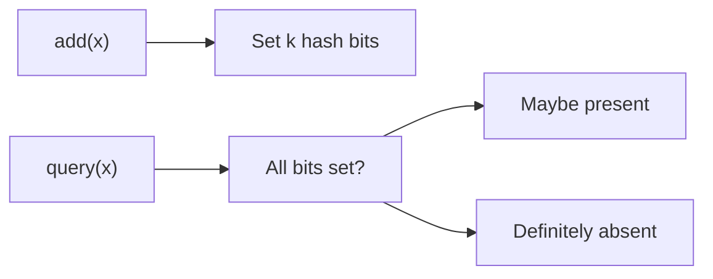

# 89. Bloom filters and probabilistic structures?

> Part C: Advanced Patterns and Reliability

**Answer:** Bloom filter: bit array + k hashes; no false negatives, possible false positives; used to skip disk lookups, dedup crawlers, cache penetration protection. Count-Min Sketch (frequencies), HyperLogLog (cardinality), Cuckoo filter (supports delete).

---
[⬆ Back to index](../../README.md#-question-index)
