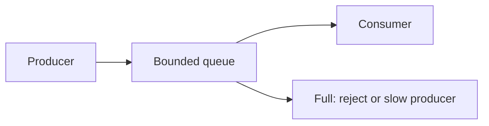

# 90. Backpressure and load shedding?

> Part C: Advanced Patterns and Reliability

**Answer:** Prevent overload by propagating slowness upstream: bounded queues, rate limits, reactive streams, shedding low-priority work (return 503/degrade), adaptive concurrency limits, autoscaling with warm capacity.

---
[⬆ Back to index](../../README.md#-question-index)
