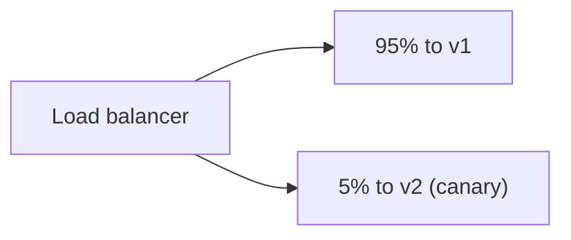

# 91. Deployment strategies: blue-green, canary, rolling?

> Part C: Advanced Patterns and Reliability

**Answer:** Blue-green: two environments, switch traffic instantly, easy rollback. Canary: route small percentage, watch metrics, ramp up. Rolling: replace instances gradually. Use feature flags and backward-compatible DB migrations (expand/contract).

---
[⬆ Back to index](../../README.md#-question-index)
