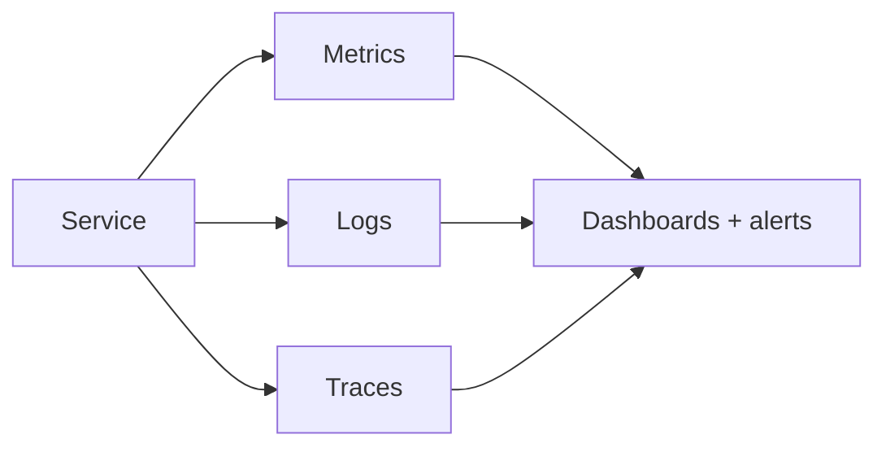

# 93. Observability: logs, metrics, traces, SLO/SLI?

> Part C: Advanced Patterns and Reliability

**Answer:** Metrics (RED: rate, errors, duration; USE for resources), structured logs with correlation IDs, distributed traces. Define SLIs/SLOs and error budgets; alert on symptoms (user impact) not causes; runbooks and post-mortems.

---
[⬆ Back to index](../../README.md#-question-index)
