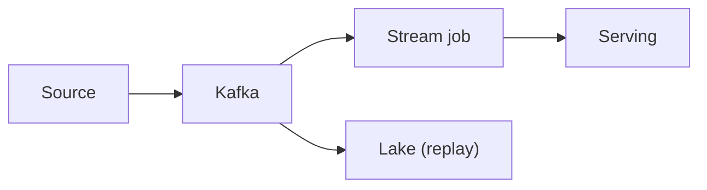

# 94. Data pipeline architectures: Lambda vs Kappa; batch vs stream?

> Part C: Advanced Patterns and Reliability

**Answer:** Lambda: batch layer (accurate) + speed layer (fast) merged at serving. Kappa: a single streaming path with log replay for reprocessing. Modern: stream-first with lakehouse (Iceberg/Delta), exactly-once semantics via checkpoints.

---
[⬆ Back to index](../../README.md#-question-index)
