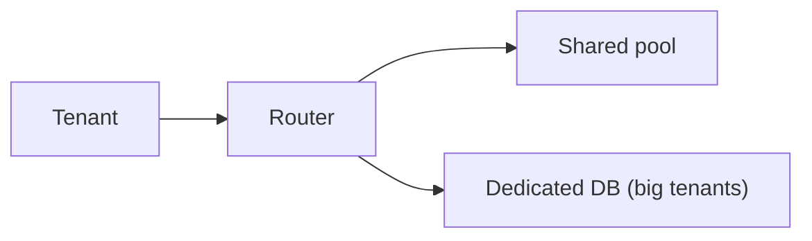

# 98. Multi-tenancy and data isolation (SaaS)?

> Part C: Advanced Patterns and Reliability

**Answer:** Models: shared DB shared schema (tenant_id column + row-level security), schema per tenant, database per tenant (strong isolation). Add per-tenant rate limits and quotas (noisy neighbor), encryption keys per tenant, tenant-aware sharding.

---
[⬆ Back to index](../../README.md#-question-index)
