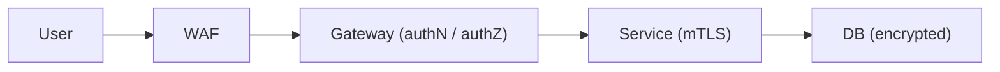

# 99. Security in system design (zero trust, encryption, secrets)?

> Part C: Advanced Patterns and Reliability

**Answer:** TLS everywhere + mTLS between services, encryption at rest (KMS, envelope encryption), least privilege IAM, secrets manager rotation, input validation, WAF/DDoS protection, audit logging, PII minimization, defense in depth.

---
[⬆ Back to index](../../README.md#-question-index)
