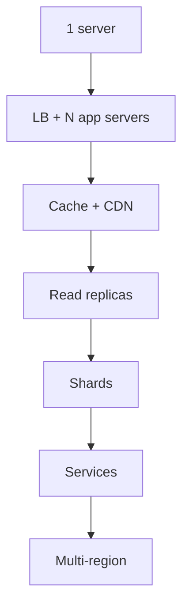

# 100. How do you scale a system from 0 to millions of users?

> Part C: Advanced Patterns and Reliability

**Answer:** Start with a single server; separate web and DB; add load balancer and stateless app tier; DB replication, cache, CDN; move assets to object storage; shard the DB; introduce queues/async workers; split into services; multi-region; invest in monitoring and automation at each step. Optimize the current bottleneck, measured, not guessed.

---
[⬆ Back to index](../../README.md#-question-index)
