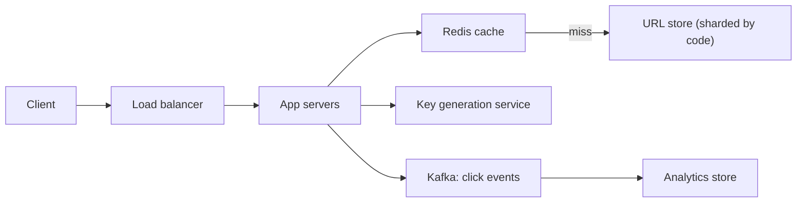

# Deep Dive: URL Shortener (TinyURL)

> Related: [Question 31](../02-classic-designs/031-design-a-url-shortener-tinyurl.md)

## 1. Requirements
- **Functional:** create a short link, redirect to the original, optional custom alias and expiry, basic click analytics.
- **Non-functional:** very low redirect latency, high availability, links should not be guessable in bulk.

## 2. Capacity estimate
| Item | Number |
|:--|:--|
| New URLs | 100M per month, about 40 writes/s |
| Read:write ratio | 100:1, about 4,000 redirects/s (peak 3x) |
| Storage (5 years) | 6B URLs x 500 B, about 3 TB |
| Code length | 7 chars base62, 62^7 is about 3.5T combinations |

## 3. API
```
POST /v1/urls   {long_url, custom_alias?, expires_at?}  ->  {short_url}
GET  /{code}                                            ->  301 or 302 redirect
```

## 4. Data model
`urls(code PK, long_url, user_id, created_at, expires_at)` in a key-value or wide-column store. Access is always by `code`, so there are no joins.

## 5. Architecture


## 6. Deep dive: generating the code
| Approach | Pros | Cons |
|:--|:--|:--|
| Hash (MD5) and take 7 chars | No coordination | Collisions, needs retry |
| Counter + base62 | No collisions | Sequential, so guessable |
| Key generation service (pre-made keys) | Fast, no collisions | Extra component to run |

Best answer: a key generation service hands each app server a range of unused keys. Shuffle or encrypt the counter so codes are not guessable.

## 7. Details interviewers probe
- **301 vs 302:** 301 is cached by browsers (less load, no analytics); 302 gives accurate click counts.
- **Caching:** cache the hottest 20% of codes with LRU; the redirect path reads cache first.
- **Expiry:** lazy delete on read plus a background cleanup job.
- **Abuse:** rate limit creation, scan target URLs for malware.

## 8. Trade-offs
Choose availability over strict consistency: a brief delay before a new link works everywhere is acceptable.
