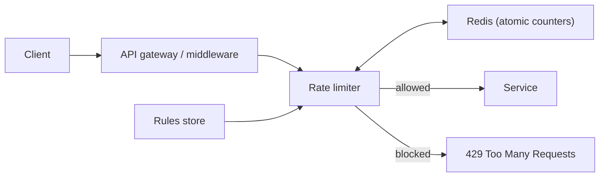

# Deep Dive: Rate Limiter

> Related: [Question 16](../01-fundamentals/016-how-do-you-design-a-rate-limiter.md)

## 1. Requirements
- Limit requests per user, IP or API key (for example 100 per minute).
- Add under 5 ms of latency, work across many servers, return HTTP 429 with `Retry-After`.

## 2. Algorithms
| Algorithm | How it works | Trade-off |
|:--|:--|:--|
| Token bucket | Tokens refill at a fixed rate, each request takes one | Allows bursts, simple, most used |
| Leaky bucket | Requests drain at a constant rate | Smooth output, no bursts |
| Fixed window | Counter per time window | Burst at window edges |
| Sliding window log | Store timestamps | Accurate, memory heavy |
| Sliding window counter | Weighted blend of two windows | Good accuracy, low memory |

## 3. Architecture

## 4. Token bucket in Redis (atomic)
Keep `tokens` and `last_refill` per key. A Lua script refills based on elapsed time, checks tokens and decrements in one atomic step. This avoids race conditions between servers.

## 5. Details interviewers probe
- **Distributed:** central Redis with atomic Lua, or local counters synced periodically for lower latency.
- **Fail open or closed?** Usually fail open if Redis is down, but fail closed for security endpoints.
- **Headers:** `X-RateLimit-Limit`, `X-RateLimit-Remaining`, `Retry-After`.
- **Hot keys:** shard counters by key hash, add per-IP limits before per-user limits.

## 6. Trade-offs
Accuracy versus latency: strict global limits need a central store; approximate limits can run locally.
