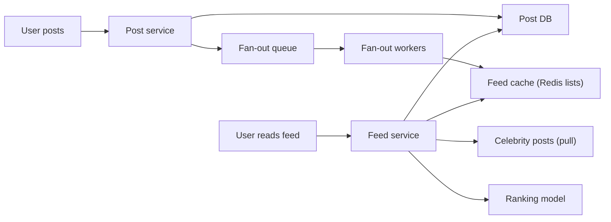

# Deep Dive: News Feed

> Related: [Question 37](../02-classic-designs/037-design-a-news-feed-facebook-twitter-timeline.md)

## 1. Requirements
- Users post, follow others and see a ranked feed. Feed load under 200 ms.
- Eventually consistent is fine; a post may appear a few seconds late.

## 2. Estimate
300M DAU, each opens the feed 10 times a day: about 35K feed reads/s. Writes are far fewer, so the design optimises reads.

## 3. Fan-out strategies
| Strategy | How | Good for | Problem |
|:--|:--|:--|:--|
| Fan-out on write (push) | On post, add the id to every follower's feed cache | Fast reads | Celebrity with 50M followers |
| Fan-out on read (pull) | Build the feed at read time | Celebrities | Slow reads |
| Hybrid | Push for normal users, pull for celebrities, merge at read | Real systems | More complexity |

## 4. Architecture

## 5. Data model
- `posts(post_id, author_id, content, media_url, created_at)` sharded by author.
- `follows(follower_id, followee_id)` graph store.
- Feed cache: `feed:{user_id}` is a list of post ids, capped at about 800.

## 6. Details interviewers probe
- **Skip inactive users** during fan-out to save work.
- **Ranking:** recency plus engagement features from a feature store.
- **Media:** object storage plus CDN, never in the DB.
- **Deletes:** mark a post deleted and filter it at read time.
