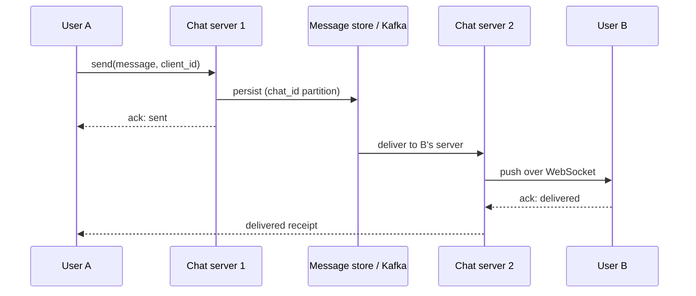

# Deep Dive: Chat System (WhatsApp / Messenger)

> Related: [Question 40](../02-classic-designs/040-design-a-chat-system-whatsapp-messenger.md)

## 1. Requirements
- 1:1 and group chat, delivery and read receipts, online presence, offline delivery with push.
- Messages are not lost, ordered within a chat, delivered in under a second when online.

## 2. Connection layer
Clients keep a persistent **WebSocket** to a chat server. A session service stores `user_id -> chat_server`. Chat servers are stateful in connections only; messages live in the store.

## 3. Sending a message

If B is offline, the message stays in the store and a push notification (APNs/FCM) is sent. On reconnect, B syncs messages after its last seen sequence id.

## 4. Data model
`messages(chat_id, seq_id, sender_id, body, created_at)` in a wide-column store, partitioned by `chat_id`, ordered by `seq_id`. Per-chat sequence ids give strict ordering.

## 5. Details interviewers probe
- **Groups:** small groups fan out to members; large channels use pull with per-user read cursors.
- **Presence:** heartbeats in Redis with TTL, publish changes only to online friends.
- **Duplicates:** client generates `client_id`, server dedups (idempotency).
- **Security:** end-to-end encryption (Signal protocol), server stores only ciphertext.
- **Scale:** millions of connections per cluster; shard by user id, keep connection servers lightweight.
