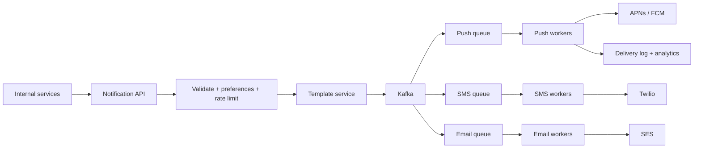

# Deep Dive: Notification System

> Related: [Question 36](../02-classic-designs/036-design-a-notification-system-push-sms-email.md)

## 1. Requirements
- Push (APNs/FCM), SMS, email and in-app. Respect user preferences and quiet hours.
- Soft real-time, no lost notifications, no duplicates, handle traffic spikes.

## 2. Architecture

## 3. Reliability
- **At-least-once** delivery with a dedup key `(user_id, event_id, channel)` stored in Redis.
- Retries with exponential backoff and jitter, then a dead letter queue.
- Separate queues per channel and priority so a flood of marketing email cannot delay OTP codes.

## 4. Data model
- `preferences(user_id, channel, enabled, quiet_hours)`
- `device_tokens(user_id, platform, token)`
- `notifications(id, user_id, channel, status, created_at)`

## 5. Details interviewers probe
- **Rate limit per user** to avoid spamming; collapse similar events into a digest.
- **Provider failure:** fail over to a second SMS or email provider.
- **Scheduling:** delayed jobs in a scheduler for "send at 9am local time".
- **Tracking:** delivery, open and click events flow back through webhooks.
