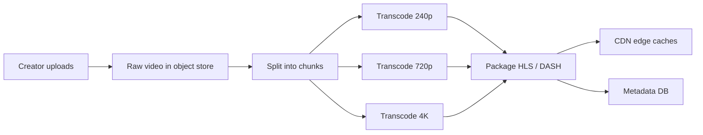

# Deep Dive: Video Streaming (YouTube / Netflix)

> Related: [Question 43](../02-classic-designs/043-design-youtube-netflix-video-streaming.md)

## 1. Requirements
- Upload videos, play with no buffering on any device or network, search and recommend.
- Read-heavy; storage and bandwidth are the main costs.

## 2. Upload and transcoding pipeline

## 3. Playback
The player downloads a manifest and fetches 2 to 10 second segments, switching bitrate based on measured bandwidth (**adaptive bitrate streaming**). Popular content is cached at the edge or inside ISP networks.

## 4. Details interviewers probe
- **Chunked upload:** resumable multipart upload from the client.
- **Transcoding as a DAG** of tasks on an elastic worker pool; thumbnails, audio and subtitles are extra tasks.
- **Cost:** keep hot videos on CDN, cold videos in cheaper storage tiers.
- **Views and likes:** counted via a streaming pipeline and aggregated, not updated row by row.
- **Safety:** copyright and content checks before publishing; signed URLs for private videos.
- **Recommendations:** candidate generation then ranking (see question 64).
