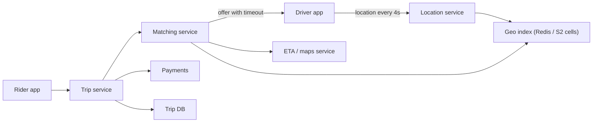

# Deep Dive: Ride Hailing (Uber)

> Related: [Question 45](../02-classic-designs/045-design-uber-ride-hailing.md)

## 1. Requirements
- Rider requests a trip, the nearest suitable driver is matched, both see live location, fare and payment.
- Match in seconds, handle millions of drivers sending location every few seconds.

## 2. Architecture

## 3. Finding nearby drivers
Split the map into **geohash or S2 cells**. A driver's cell is updated on each ping. A rider request searches the rider's cell and neighbouring cells, then ranks by real ETA (not straight-line distance).

## 4. Matching flow
1. Rider requests a trip.
2. Matching service picks top N candidate drivers.
3. Offer to the best one with a 10 second timeout; on decline go to the next.
4. Lock the driver so two riders are never matched to the same driver.

## 5. Details interviewers probe
- **Trip state machine:** requested, matched, arrived, started, completed, paid.
- **Live updates:** WebSocket or push for location streaming.
- **Surge pricing:** compute supply and demand per cell every minute.
- **Reliability:** drivers' location store is ephemeral and rebuilt from pings; trips are durable.
