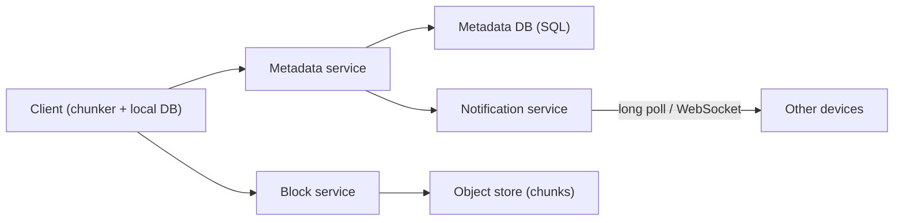

# Deep Dive: File Storage and Sync (Google Drive / Dropbox)

> Related: [Question 44](../02-classic-designs/044-design-google-drive-dropbox.md)

## 1. Requirements
- Upload, download and sync files across devices, share with others, keep version history.
- Handle large files, flaky networks and conflicting edits.

## 2. Architecture

## 3. How sync works
1. Split the file into about 4 MB chunks and hash each chunk.
2. Ask the server which hashes it already has (**deduplication**).
3. Upload only missing chunks, in parallel and resumable.
4. Commit the new file version (list of chunk hashes) in the metadata DB.
5. Notify other devices, which download only changed chunks (**delta sync**).

## 4. Data model
`files(file_id, owner, name, version, chunk_hashes[])`, `chunks(hash, storage_url, ref_count)`, `shares(file_id, user_id, permission)`.

## 5. Details interviewers probe
- **Conflicts:** keep both versions ("conflicted copy") or last-writer-wins with version history.
- **Compression and encryption** at the client and at rest.
- **Offline mode:** local change log replays when back online.
- **Cost:** move old versions and cold files to cheaper storage.
