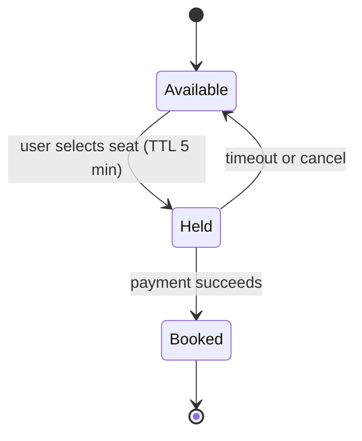
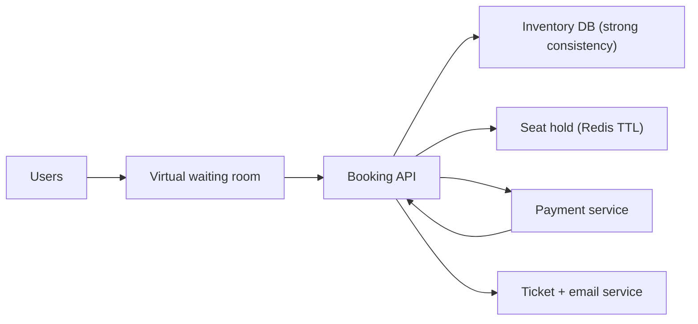

# Deep Dive: Ticket Booking (Ticketmaster)

> Related: [Question 48](../02-classic-designs/048-design-a-ticket-booking-system-ticketmaster.md)

## 1. Requirements
- Browse events, choose seats, pay, receive tickets.
- **Never sell the same seat twice**, even when a hot event brings a huge spike.

## 2. Booking flow

## 3. Architecture

## 4. Preventing double booking
- Use a DB transaction with `UPDATE seats SET status='HELD' WHERE id=? AND status='AVAILABLE'` and check the affected row count (optimistic check), or a unique constraint on `(event_id, seat_id)`.
- Hold with a TTL so abandoned carts release seats automatically.
- Payments use idempotency keys so a retry never charges twice.

## 5. Handling the spike
- **Virtual waiting room:** let users in at a controlled rate.
- Cache the static event and venue data on a CDN.
- Read seat maps from a cache, but write through the strongly consistent DB.

## 6. Trade-offs
Consistency matters more than availability for inventory: it is better to show a brief error than to oversell.
