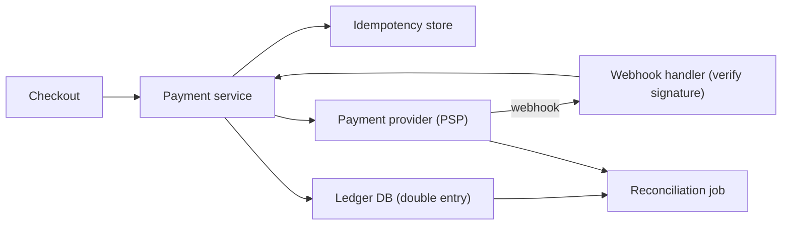
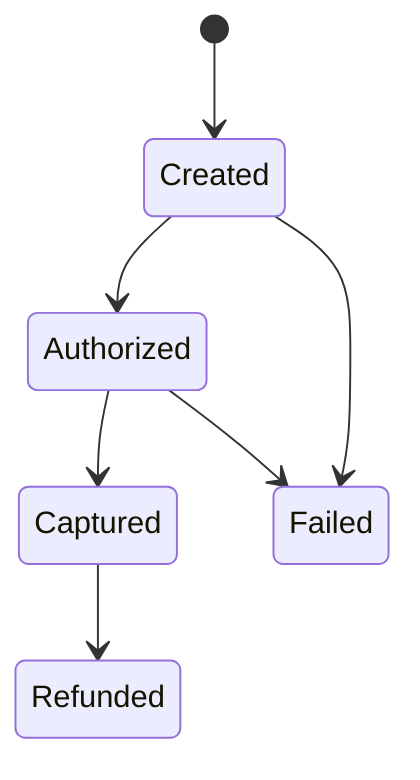

# Deep Dive: Payment System

> Related: [Question 52](../02-classic-designs/052-design-a-payment-system.md)

## 1. Requirements
- Charge customers through external payment providers (PSPs), support refunds, never double charge, keep an exact record of money.

## 2. Architecture

## 3. Payment state machine

## 4. Key ideas
- **Idempotency key** per payment attempt: a retry returns the original result instead of charging twice.
- **Double-entry ledger:** every transaction records a debit and an equal credit, so the books always balance and are auditable. Ledger rows are append-only.
- **Reconciliation:** a nightly job compares our ledger with the PSP's settlement report and flags mismatches.
- **Timeouts:** if the PSP call times out, the status is unknown. Query the PSP by idempotency key rather than guessing.
- **PCI:** never store raw card numbers; use hosted fields and tokens.

## 5. Details interviewers probe
- Use a **saga** for order, inventory and payment across services (question 81).
- Use the **outbox pattern** so payment events are never lost (question 84).
- Fraud checks run before capture; high-risk payments go to manual review.
- Support multiple PSPs with failover and per-region routing.
